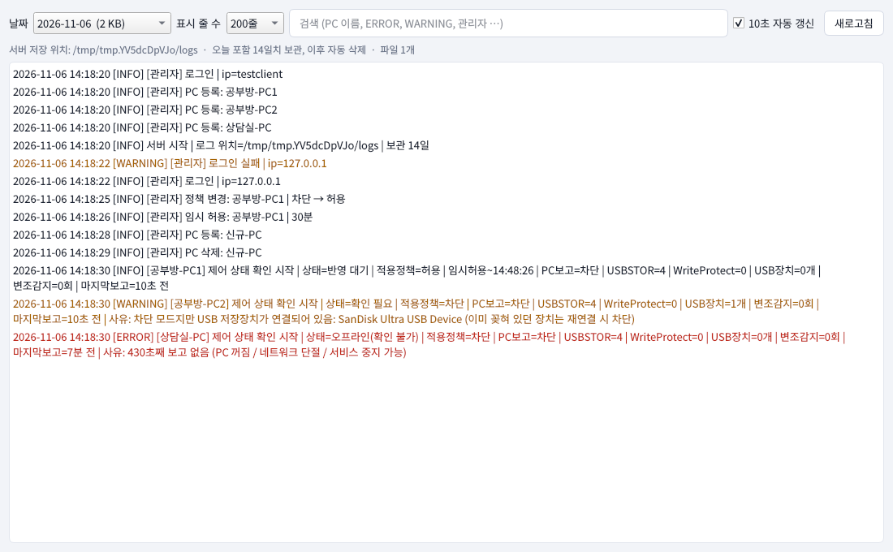
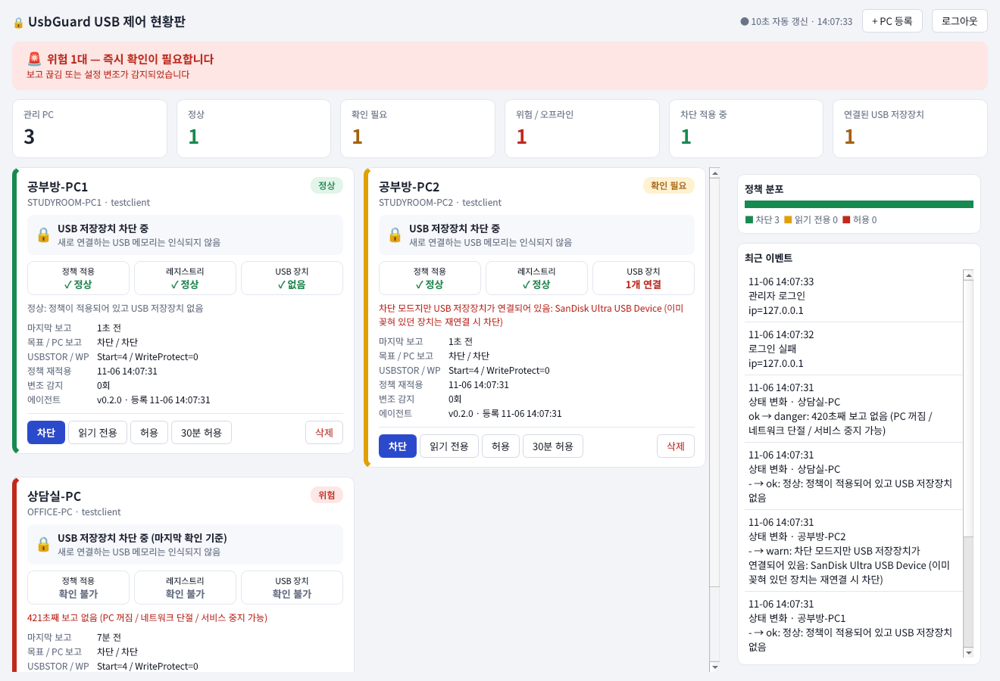
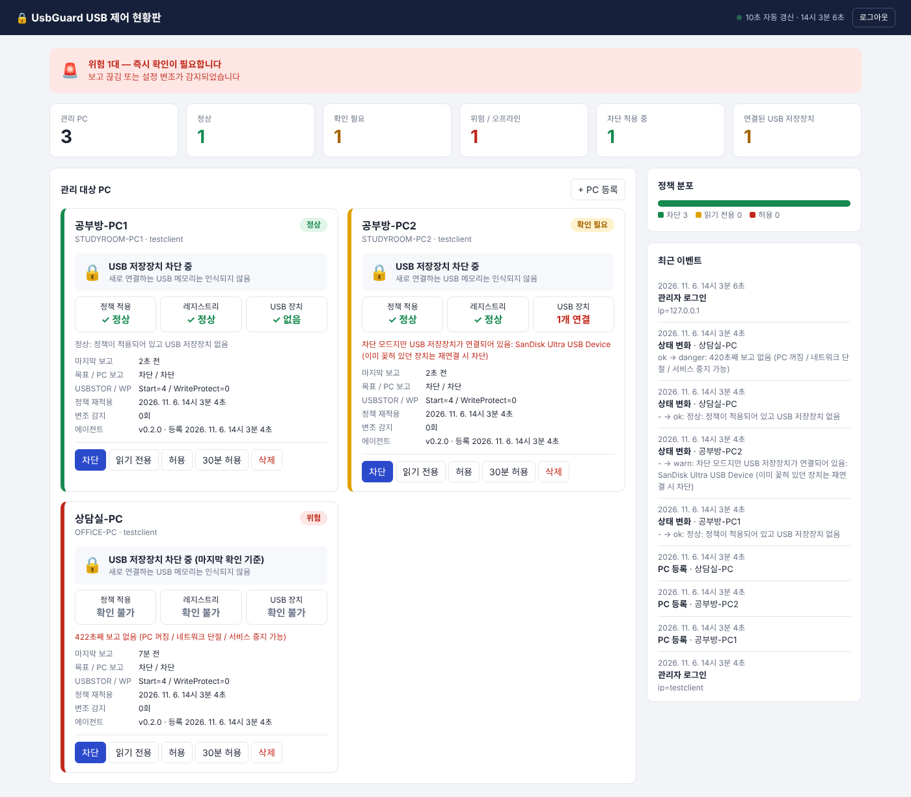

# UsbGuard — Windows USB 저장장치 제어 + 중앙 상태 확인

Windows PC 가 USB 메모리(저장장치)를 인식하지 못하게 제어하고, **관리자만** 중앙에서 모든 PC 의 제어 상태를 확인·변경하는 시스템입니다.

```
[USB 제어 PC]                                   [관리자 서버 PC]                      [관리자 PC]
 UsbGuard 서비스  ──(30초마다 HTTP, PC→서버)──▶  FastAPI + SQLite  ◀──────────────  관리자 데스크톱 앱
  · USB 정책 적용(레지스트리)                     · 상태 판정 / 정책 배포               (또는 웹 현황판)
  · 변조 감지 / 상태 수집                         · 제어 상태 로그(14일)                · 비밀번호 로그인
  · GUI 없음                                      · 관리자 비밀번호 검증
```

## 목차
- [어떤 설정을 어디에 하나](#어떤-설정을-어디에-하나)
- [설치 순서 한눈에 보기](#설치-순서-한눈에-보기)
- [PART A. 관리자용 설정](#part-a-관리자용-설정) — 서버 PC + 관리자 PC
- [PART B. USB 제어 PC 설정](#part-b-usb-제어-pc-설정) — 대상 PC
- [공통 참고](#공통-참고) — 상태 의미 · 동작 원리 · 테스트 · 한계

---

## 어떤 설정을 어디에 하나

| 구분 | 설치 대상 | 무엇을 설치/설정하나 | 폴더 | 필요한 것 |
|---|---|---|---|---|
| **A-1. 서버** | 항상 켜져 있는 PC 1대 | 중앙 서버(상태 판정·정책 배포·로그 저장), 관리자 비밀번호 | `server/` | Python 3.11+ |
| **A-2. 관리자 앱** | 관리자가 쓰는 PC | 데스크톱 현황판 (로그인 후 PC 상태 확인·정책 변경·로그 조회) | `admin_gui/` | Python 3.11+ 또는 exe |
| **B. USB 제어 PC** | USB 를 제어할 PC 전체(약 3대) | UsbGuard 서비스(에이전트) + 로컬 CLI, 서버 등록 | `Service/`, `Admin/`, `Common/` | .NET 8, 관리자 권한 |

> 폴더 이름 주의: `Admin/` 은 **USB 제어 PC 용** 로컬 CLI(`usbguard.exe`)이고, `admin_gui/` 가 **관리자용** 데스크톱 앱입니다.

## 설치 순서 한눈에 보기

1. **(A-1)** 서버 PC 에 서버를 설치하고 관리자 비밀번호를 설정한 뒤 실행(서비스 등록)
2. **(A-2)** 관리자 PC 에서 데스크톱 앱을 실행해 로그인
3. **(A-2)** 앱에서 **+ PC 등록** → PC 이름 입력 → **등록 토큰**(한 번만 표시) 확인
4. **(B)** USB 제어 PC 에 서비스를 설치하고, 3번의 토큰으로 서버에 등록(`enroll`)
5. **(A-2)** 앱 현황판에 해당 PC 가 **정상**으로 뜨는지 확인 → 나머지 PC 도 3~5번 반복

---

# PART A. 관리자용 설정

관리자만 접근합니다. 서버 PC 는 로그가 끊기지 않도록 **항상 켜져 있는 PC** 여야 합니다.

## A-1. 서버 설정 (서버 PC)

### 1) 설치
```
cd server
pip install -r requirements.txt
```

### 2) 관리자 비밀번호 설정 (최초 1회, 10자 이상)
```
python manage.py set-admin-password
```
- 관리자 비밀번호는 **서버에서만** 검증합니다. (USB 제어 PC 에는 저장되지 않음)
- 변경할 때도 같은 명령을 다시 실행합니다.
- 로그인 5회 실패 시 해당 IP 는 5분간 잠깁니다. 로그인 세션은 8시간 유지됩니다.

### 3) 실행
```
uvicorn app:app --host 0.0.0.0 --port 8080
```
- Windows 방화벽에서 서버 PC 의 **TCP 8080 인바운드**를 허용하세요 (USB 제어 PC 와 관리자 PC 가 접속).
- 브라우저로 `http://<서버IP>:8080` 에 접속하면 웹 현황판도 열립니다(선택).

### 4) 상시 실행 서비스로 등록 (권장, 관리자 권한)
서버가 멈춘 시간에는 **제어 상태 로그가 남지 않으므로**, 부팅 시 자동 실행되고 비정상 종료 시 자동 재시작되게 등록합니다. ([NSSM](https://nssm.cc) 사용 — 아래 명령은 Windows 에서 미검증 초안)
```
nssm install UsbGuardServer "C:\Python312\python.exe" "-m uvicorn app:app --host 0.0.0.0 --port 8080"
nssm set UsbGuardServer AppDirectory C:\UsbGuard\server
nssm set UsbGuardServer AppEnvironmentExtra USBGUARD_DATA=C:\UsbGuard\data
nssm set UsbGuardServer Start SERVICE_AUTO_START
nssm set UsbGuardServer AppExit Default Restart
nssm start UsbGuardServer
```
- `USBGUARD_DATA` 를 지정했다면 2)의 `python manage.py set-admin-password` 도 **같은 값**으로 실행해야 같은 DB 를 씁니다.
  (예: `set USBGUARD_DATA=C:\UsbGuard\data` 후 실행)

### 5) 서버 설정값 정리

| 항목 | 기본값 | 변경 방법 |
|---|---|---|
| 접속 포트 | `8080` | uvicorn `--port` |
| 데이터 폴더(DB `usbguard.db`) | `server\data` | 환경변수 `USBGUARD_DATA` |
| 로그 폴더 | `<데이터 폴더>\logs` | 환경변수 `USBGUARD_LOG_DIR` |
| 관리자 비밀번호 | (없음, 설정 필수) | `python manage.py set-admin-password` |
| 오프라인(위험) 판정 | 보고 100초 이상 없음 | `server/app.py` `OFFLINE_SEC` |
| 로그 보관 | 오늘 포함 14일 | `server/logstore.py` `RETENTION_DAYS` |
| 주기 점검 로그 | 10분 | `server/logstore.py` `SNAPSHOT_SEC` |

백업은 서버를 멈춘 뒤 데이터 폴더의 `usbguard.db` 를 복사하면 됩니다.

### 6) 서버 제어 상태 로그 (서버가 상시 기록 — 관리자 앱이 꺼져 있어도 쌓임)

| 항목 | 내용 |
|---|---|
| 파일명 | `log_yyyymmdd.log` (서버 PC 현지 날짜 기준 하루 1개, UTF-8, 자정에 자동으로 새 파일) |
| 보관 | **오늘 포함 14일치**만 유지. 그보다 오래된 `log_yyyymmdd.log` 는 서버 시작 시와 날짜가 바뀔 때 자동 삭제(삭제 사실도 기록). 형식이 다른 파일·폴더는 삭제하지 않음 |
| 변화 즉시 기록 | 상태 변경(제어 정상/확인 필요/위험/오프라인), 적용 정책 변경, USB 저장장치 연결·해제, 설정 변조 감지 — 서버가 10초마다 판정 |
| 주기 기록 | 변화가 없어도 10분마다 PC별 "제어 상태 점검" 1줄 → 그 시간 동안 제어가 유지되었음을 확인 가능 |
| 기타 | 서버 시작·종료, 관리자 로그인(실패 포함), 정책 변경, 30분 허용, PC 등록·삭제, 등록되지 않은 토큰의 보고 시도(같은 IP 10분에 1회) |

```
2026-11-06 14:17:38 [WARNING] [공부방-PC2] 제어 상태 확인 시작 | 상태=확인 필요 | 적용정책=차단 | PC보고=차단 | USBSTOR=4 | WriteProtect=0 | USB장치=1개 | ... | 사유: 차단 모드지만 USB 저장장치가 연결되어 있음: SanDisk ...
2026-11-06 14:17:33 [INFO] [관리자] 정책 변경: 공부방-PC1 | 차단 → 허용
```
레벨: 정상·반영 대기 `INFO` / 확인 필요·차단 모드 중 USB 연결 `WARNING` / 위험·오프라인·변조 감지 `ERROR`.
조회는 관리자 앱의 **서버 로그** 화면, 또는 API(`GET /api/logs`, `GET /api/logs/log_yyyymmdd.log?tail=500`, 관리자 로그인 필요)로 합니다.



## A-2. 관리자 앱 설정 (관리자 PC)

### 1) 설치·실행
```
cd admin_gui
pip install -r requirements.txt
python usbguard_gui.py
```
단일 exe 로 배포하려면:
```
pip install pyinstaller
pyinstaller --noconsole --onefile --name UsbGuardAdmin usbguard_gui.py
```

### 2) 로그인
실행하면 로그인 창이 뜹니다.
- **서버 주소**: `http://<서버IP>:8080` (마지막 입력값을 기억)
- **관리자 비밀번호**: A-1 의 2)에서 설정한 비밀번호

세션이 만료되면 재로그인 창이 다시 뜹니다.

### 3) 사용법


| 하고 싶은 일 | 방법 |
|---|---|
| PC 상태 보기 | 현황판: 전체 상태 배너, 요약 지표, PC별 카드(제어 상태·검증 3종·마지막 보고·변조 감지) — 10초 자동 갱신 |
| 정책 변경 | PC 카드의 **차단 / 읽기 전용 / 허용** 버튼 |
| 잠깐 허용 | **30분 허용** (시간이 지나면 원래 정책으로 자동 복귀) |
| PC 추가 | 상단 **+ PC 등록** → 이름 입력 → 토큰·`enroll` 명령 표시(한 번만, 복사 버튼) → [PART B](#part-b-usb-제어-pc-설정) 에서 사용 |
| PC 삭제 | PC 카드의 **삭제** (해당 PC 는 보고가 거부되고 마지막 정책을 유지) |
| 로그 보기 | 상단 **서버 로그** — 날짜 선택, 표시 줄 수, 검색, ERROR/WARNING 색 표시, 자동 갱신 |

앱 자체는 로그 파일을 만들지 않습니다(로그는 서버가 상시 기록). 웹 현황판(`http://<서버IP>:8080`)으로도 같은 현황을 볼 수 있습니다.

---

# PART B. USB 제어 PC 설정

USB 를 제어할 PC(약 3대) **각각**에 수행합니다. 이 PC 에는 GUI 가 없고, 사용자는 **일반 사용자 권한**으로 쓰는 것이 전제입니다(관리자 권한 사용자는 서비스를 끌 수 있음).

## B-1. 준비물
- Windows 10/11, **관리자 권한**으로 설치
- [.NET 8 런타임](https://dotnet.microsoft.com/download/dotnet/8.0) (빌드는 .NET 8 SDK)
- 서버 PC 의 `8080` 포트로 **아웃바운드 접속**이 가능할 것 (같은 네트워크 대역)
- 관리자 앱에서 발급받은 **등록 토큰** ([설치 순서](#설치-순서-한눈에-보기) 3번)

## B-2. 빌드 (개발 PC 에서 1회)
```
dotnet publish Service -c Release -r win-x64 --self-contained false -o out\svc
dotnet publish Admin   -c Release -r win-x64 --self-contained false -o out\admin
```
생성된 `out\svc`, `out\admin` 폴더를 각 PC 의 `C:\UsbGuard\svc`, `C:\UsbGuard\admin` 으로 복사합니다.

## B-3. 서비스 설치 (관리자 권한 명령 프롬프트)
```
sc.exe create UsbGuardSvc binPath= "C:\UsbGuard\svc\UsbGuard.Service.exe" start= auto obj= LocalSystem
sc.exe failure UsbGuardSvc reset= 0 actions= restart/5000/restart/5000/restart/5000
sc.exe start UsbGuardSvc
```
- 부팅 시 자동 시작, 비정상 종료 시 5초 후 자동 재시작
- 서비스 시작 직후 기본 정책은 **차단**입니다.

## B-4. 로컬 비밀번호 설정 (최초 1회, 8자 이상)
```
C:\UsbGuard\admin\usbguard.exe setup
```
이 비밀번호는 **비상용**입니다(서버를 못 쓸 때 로컬 제어·연동 해제). 서버 관리자 비밀번호와 별개입니다.

## B-5. 서버에 등록
```
C:\UsbGuard\admin\usbguard.exe enroll http://<서버IP>:8080 <토큰>
```
- 로컬 비밀번호를 묻습니다. 등록되면 **30초 이내**에 첫 보고가 갑니다.
- 등록 후에는 서버가 정책을 관리하고, 이 PC 에서의 로컬 모드 변경(`block/allow/…`)은 거부됩니다.

## B-6. 확인
```
C:\UsbGuard\admin\usbguard.exe status
```
`서버 관리 모드` 와 현재 적용 정책이 표시됩니다. 관리자 앱 현황판에서 해당 PC 가 **정상**인지 확인합니다.

## B-7. 로컬 CLI 명령 (`usbguard.exe`)

| 명령 | 설명 | 서버 관리 중 |
|---|---|---|
| `status` | 현재 상태 조회 (비밀번호 불필요) | 가능 |
| `setup` | 로컬 비밀번호 최초 설정 | — |
| `enroll <서버URL> <토큰>` | 서버 등록 | — |
| `unenroll` | 서버 연동 해제(로컬 관리로 복귀), 비상용 | 가능 |
| `block` / `readonly` / `allow` | 로컬에서 모드 변경 | **거부** |
| `tempallow <분>` | 임시 허용(1~480분) | **거부** |
| `passwd` | 로컬 비밀번호 변경 | 가능 |

로컬 비밀번호를 5번 틀리면 5분간 잠깁니다.

## B-8. 동작 원리 (이 PC 에서 일어나는 일)
- **차단**: `HKLM\SYSTEM\CurrentControlSet\Services\USBSTOR\Start = 4` → 새로 꽂는 USB 메모리가 인식되지 않음
- **읽기 전용**: `Start = 3` + `HKLM\SYSTEM\CurrentControlSet\Control\StorageDevicePolicies\WriteProtect = 1`
- **허용**: `Start = 3`, `WriteProtect = 0`
- 서비스가 **5초마다** 값을 다시 적용합니다. 같은 모드인데 값이 바뀌어 있었다면 변조로 카운트해 서버에 보고합니다.
- **30초마다** 서버로 상태(레지스트리 실제값, 연결된 USB 저장장치 목록, 변조 횟수)를 보고하고, 응답으로 정책을 받습니다.
- 서버에 접속할 수 없어도 **마지막으로 받은 정책을 계속 적용**합니다.
- 설정 파일: `C:\ProgramData\UsbGuard\config.json` (SYSTEM·Administrators 만 접근 가능, 로컬 비밀번호 해시와 서버 주소·토큰 저장)

## B-9. 제거(언인스톨) — 순서 중요
서비스를 멈추거나 지워도 **레지스트리에 걸린 차단은 그대로 남습니다.** 먼저 허용으로 돌려 놓고 제거하세요.
```
:: 1) 서버에서 이 PC 를 '허용'으로 변경하거나, 서버 연동을 해제하고 로컬에서 허용
C:\UsbGuard\admin\usbguard.exe unenroll
C:\UsbGuard\admin\usbguard.exe allow
:: 2) 서비스가 레지스트리를 반영할 때까지 10초 정도 대기 후 서비스 제거
sc.exe stop UsbGuardSvc
sc.exe delete UsbGuardSvc
```
이후 관리자 앱에서 해당 PC 를 **삭제**합니다.

---

# 공통 참고

## 상태 의미
| 상태 | 의미 |
|---|---|
| 정상 | 목표 정책과 PC 실제값(서비스 판정 + 레지스트리 실제값)이 일치하고, 차단 모드에서 USB 저장장치가 없음 |
| 반영 대기 | 정책을 방금 바꿨고 PC 의 다음 보고(최대 30초)를 기다리는 중 |
| 확인 필요 | 정책 불일치, 또는 **차단 모드인데 USB 저장장치가 연결되어 있음** (이미 꽂혀 있던 장치) |
| 위험 | 100초 이상 보고 없음(PC 꺼짐/네트워크 단절/서비스 중지), 또는 최근 10분 내 레지스트리 변조 감지 |
| 미확인 | 등록만 되고 아직 보고 없음 |

보고가 끊긴 PC 는 마지막 값으로 "정상"처럼 보이지 않도록 검증 칸을 **확인 불가**로 표시합니다.

웹 현황판 화면 예시:



## 폴더 구성
| 경로 | 설명 |
|---|---|
| `Service/` | USB 제어 PC 의 SYSTEM 서비스 (정책 적용, 상태 수집·보고, 로컬 CLI 처리) |
| `Admin/` | USB 제어 PC 의 로컬 CLI `usbguard.exe` (서버 등록, 비상용 로컬 제어) |
| `Common/` | 프로토콜 정의 (서비스 ↔ CLI ↔ 서버) |
| `server/` | 관리자용 중앙 서버(FastAPI) + 웹 현황판 + 제어 상태 로그 (`server/logstore.py`) |
| `admin_gui/` | 관리자용 데스크톱 앱 (PySide6) |
| `docs/` | README 스크린샷 |

## 테스트
```
# 서버 (pip install httpx)
cd server
python tests/smoke_test.py        # API/상태 판정
python tests/logstore_test.py     # 일별 로그·14일 삭제 단위 테스트
python tests/server_log_test.py   # 서버 로그 통합 (시작/삭제/관리자 동작/조회 API/감시 루프)

# 관리자 앱 (pip install PySide6-Essentials httpx)
QT_QPA_PLATFORM=offscreen python admin_gui/tests/gui_test.py
```

## 한계 / 보안 메모
- **에이전트 자기 보고 기반**: 로컬 관리자 권한 사용자는 서비스를 중지·삭제할 수 있고, 이 경우 서버는 "보고 끊김(위험)"만 알 수 있음. 일반 사용자 권한 운영이 전제
- **HTTP 평문**: 사내망 전용 가정. 토큰이 평문 전송되므로 외부 노출 금지. 필요 시 HTTPS 리버스 프록시(Caddy/nginx) 뒤에 두고 `https_only=True` 로 전환
- 이미 꽂혀 있는 USB 는 즉시 해제되지 않음(재연결 시 차단). WMI `InterfaceType='USB'` 기준이라 UASP 방식 일부 외장 SSD 는 목록에서 빠질 수 있음
- 임시 허용 만료 시각은 UTC 기준이며 PC 시계 오차의 영향을 받음 (같은 대역 3대 규모에선 무시 가능). PC 시간 동기화 권장
- 서버가 멈춘 시간에는 서버 로그가 남지 않음(서비스 자동 재시작 설정 필수)
- **C# 코드(USB 제어 PC 쪽)는 아직 Windows 에서 빌드/실행 검증 전**입니다. 서버·관리자 앱(Python)은 자동 테스트로 검증됨. NSSM/sc 명령도 Windows 에서 미검증 초안
- 미구현: 시리얼 번호 화이트리스트, 장치 연결 시도 이벤트 수집, mTLS, 언인스톨 보호, 에이전트 로컬 로그
